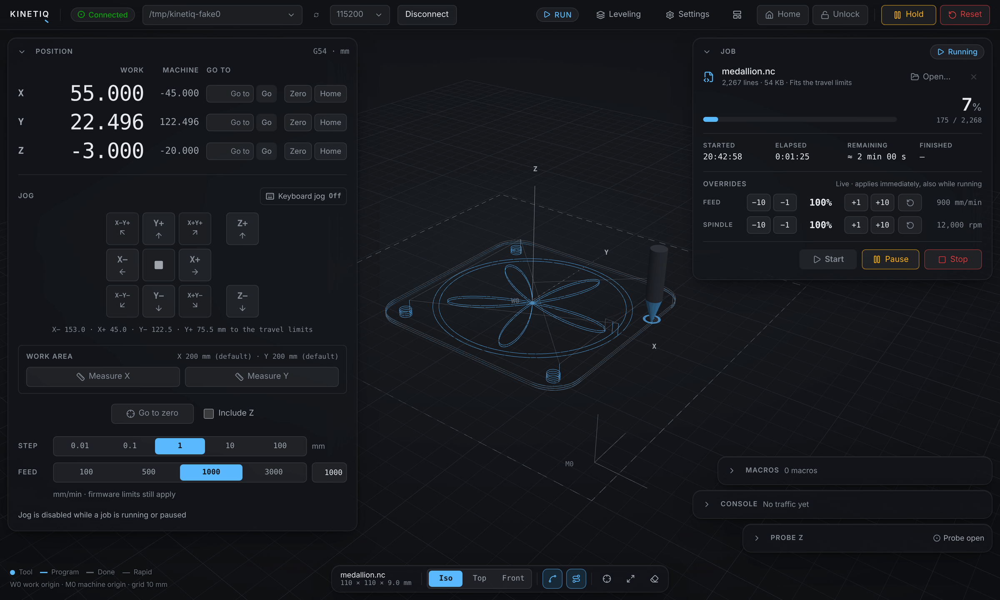

# Kinetiq

**A modern control interface for DIY CNC machines.** Kinetiq connects to a GRBL-compatible controller over USB, shows the machine live in 3D, and lets you jog, probe, level and run G-code from a browser on the computer next to the machine. It is built and used on a DIY 3-axis router running [FluidNC](https://github.com/bdring/FluidNC) on an ESP32.

<!-- Screenshot: save it as docs/images/kinetiq.png and uncomment the next line.

-->

Kinetiq is one Next.js application with a built-in CNC backend: the GRBL server code of [CNCjs](https://github.com/cncjs/cncjs), rewritten in TypeScript, handles serial communication, streaming and the safety logic.

> [!WARNING]
> **Kinetiq is not an emergency stop.** Hold and Reset are software commands that need a working computer, USB link and firmware. Your machine needs a hard-wired emergency-stop circuit that cuts power to the drivers and the spindle. You use this software at your own risk.

## Features

- **Live 3D view** of the tool, the work origin and the loaded toolpath. The executed part of a running job is greyed out.
- **Position and jog**: work and machine coordinates, a jog pad with step and feed presets, Go to, Zero and Home per axis, and optional keyboard jogging (one step per key press).
- **Jobs**: upload G-code (`.nc`, `.gcode`, `.gc`, `.ngc`, `.tap`, `.cnc`, `.txt`), keep a library of recent jobs, Start / Pause / Resume / Stop, feed and spindle overrides, and a remaining-time estimate.
- **Travel limits**: jogs are kept inside the work area and a job cannot start unless it fits ([docs/TRAVEL_LIMITS.md](docs/TRAVEL_LIMITS.md)).
- **Probe Z** with a touch plate, and **bed leveling** with a probed height map ([docs/BED_LEVELING.md](docs/BED_LEVELING.md)).
- **FluidNC settings editor**: read, edit and save `config.yaml` over USB, with automatic backups ([docs/SETTINGS_EDITOR.md](docs/SETTINGS_EDITOR.md)).
- **Macros**: saved G-code snippets you run with one click.
- **Console**: the raw traffic with the controller and a command line.
- **Fake controller** for trying the UI without a machine ([docs/FAKE_CONTROLLER.md](docs/FAKE_CONTROLLER.md)).

Every disabled control says why it is disabled, and the UI only shows state the controller has reported.

## What you need

- A CNC controller that speaks the GRBL 1.1 serial protocol, connected by USB. Kinetiq is developed against **FluidNC v4.0.1** on an ESP32. Other GRBL firmwares use the same protocol but have not been tried; the settings editor is FluidNC-only.
- A computer next to the machine with **Node.js 20 or newer** (Windows, macOS or Linux).
- A browser on that same computer. Kinetiq listens on `127.0.0.1` only (see [SECURITY.md](SECURITY.md)).

## Install and run

```bash
git clone https://github.com/FurkanGulabi/kinetiq.git
```

```bash
cd kinetiq
```

```bash
npm install
```

```bash
npm run build
```

```bash
npm start
```

Open <http://127.0.0.1:8000>. To work on the code, use `npm run dev` instead of the last two commands.

## First connection

1. Plug in the controller and close any other program that holds its serial port (another G-code sender, a serial monitor, the Arduino IDE).
2. Pick the port in the top bar. The baud rate is 115200 unless you changed it. Press **Connect**.
3. If the controller starts in **Alarm**, press **Home** (`$H`) or **Unlock** (`$X`) in the top bar.
4. Jog with the smallest steps first and check that every axis moves in the direction its button says.
5. Before the first real job, run it as an air cut: spindle off, Z zero set well above the stock.

If the port is missing or does not open, see [docs/TROUBLESHOOTING.md](docs/TROUBLESHOOTING.md).

## Adapting Kinetiq to your machine

Kinetiq's travel limits are set up for the machine it was built for. **Read this before you jog a different machine.**

That machine homes to the bottom-right corner (seen from above), which is machine X0 Y0. From there X runs negative and Y positive, and the default travel is 200 mm on both axes. Z is not limited.

| Your machine | What to do |
|---|---|
| Homes to the same corner, different size | Home the machine, then use **Measure X** and **Measure Y** in the Position widget. The measured travel is saved in `~/.kinetiqrc`. This needs a limit switch at the far end of each axis. |
| Homes to another corner | Turn the limits off. `HOME_END` in [`src/lib/machine/travel.ts`](src/lib/machine/travel.ts) sets the home corner, but only the bottom-right setting has been run on a machine. |
| No homing or no limit switches | Turn the limits off. X and Y do not jog until they are homed while the limits are on. |

To turn the limits off, set `KINETIQ_TRAVEL_LIMITS=off` before starting Kinetiq. The firmware's own soft limits then remain your only protection. [docs/TRAVEL_LIMITS.md](docs/TRAVEL_LIMITS.md) explains every rule and constant.

## Configuration

Kinetiq is configured with environment variables.

| Variable | Default | Meaning |
|---|---|---|
| `KINETIQ_PORT` | `8000` | HTTP port |
| `KINETIQ_HOST` | `127.0.0.1` | Address to listen on. Leave it on loopback ([SECURITY.md](SECURITY.md)). |
| `KINETIQ_RC` | `~/.kinetiqrc` | Config file: session secret, measured travel, macros |
| `KINETIQ_JOBS_DIR` | `~/.kinetiq/jobs` | Uploaded jobs |
| `KINETIQ_CONFIG_BACKUP_DIR` | `~/.kinetiq/config-backups` | FluidNC config backups made before each save |
| `KINETIQ_TRAVEL_LIMITS` | `on` | `off` disables the travel limits |
| `KINETIQ_LOG_LEVEL` | `info` | Backend log level. `silly` logs every serial line. |

UI preferences (widget positions, jog step, keyboard jog) are kept in the browser. Machine state is never stored: the UI always shows what the controller reports.

## Try it without a machine

A fake FluidNC controller runs on a pseudo-terminal. It needs Python 3 on macOS or Linux; on Windows run both commands inside WSL.

```bash
npm run fake-controller
```

```bash
npm run dev:fake
```

Then pick the port `kinetiq-fake0` and connect. Details are in [docs/FAKE_CONTROLLER.md](docs/FAKE_CONTROLLER.md).

## Project status

Kinetiq is a young project built around one machine. Treat it as such on yours.

- **Checked on the real machine (FluidNC v4.0.1):** connecting and status reports, homing, jogging with the travel limits, jog cancel, hold / resume / reset, feed override, reading the FluidNC config.
- **Not yet run on the real machine:** probing a height-map grid, and the controller restart after saving settings. Both work against the fake controller.
- **Everything else** was developed against the fake controller and the recorded serial protocol. Try it carefully on your own machine before you trust it with a workpiece.

There is no test suite. Backend changes are checked by recording the exact serial traffic and comparing it with a committed baseline ([scripts/protocol-scenarios/README.md](scripts/protocol-scenarios/README.md)).

## Documentation

| Document | Contents |
|---|---|
| [docs/TROUBLESHOOTING.md](docs/TROUBLESHOOTING.md) | Connection problems, alarms, disabled controls |
| [docs/TRAVEL_LIMITS.md](docs/TRAVEL_LIMITS.md) | Work-area limits and measuring the travel |
| [docs/BED_LEVELING.md](docs/BED_LEVELING.md) | Height-map probing and leveled jobs |
| [docs/SETTINGS_EDITOR.md](docs/SETTINGS_EDITOR.md) | FluidNC config editor |
| [docs/FAKE_CONTROLLER.md](docs/FAKE_CONTROLLER.md) | Developing without a machine |
| [docs/ARCHITECTURE.md](docs/ARCHITECTURE.md) | Structure, state flow, design system |
| [docs/API_REFERENCE.md](docs/API_REFERENCE.md) | Socket events, commands and HTTP APIs |
| [docs/BACKEND_INTEGRATION.md](docs/BACKEND_INTEGRATION.md) | The embedded backend, its CNCjs origin and safety mechanisms |
| [docs/hardware/](docs/hardware) | Logs of sessions on the real controller |

## Contributing

Bug reports and pull requests are welcome. Read [CONTRIBUTING.md](CONTRIBUTING.md) first: changes that affect what reaches the serial port are safety-relevant and have their own check.

## Acknowledgements

- [CNCjs](https://github.com/cncjs/cncjs) by Cheton Wu: Kinetiq's backend is a TypeScript port of its GRBL server code.
- [FluidNC](https://github.com/bdring/FluidNC), the firmware Kinetiq is built for.

## License

[MIT](LICENSE). The backend derives from CNCjs, also MIT ([src/server/CNCJS_LICENSE](src/server/CNCJS_LICENSE)).
